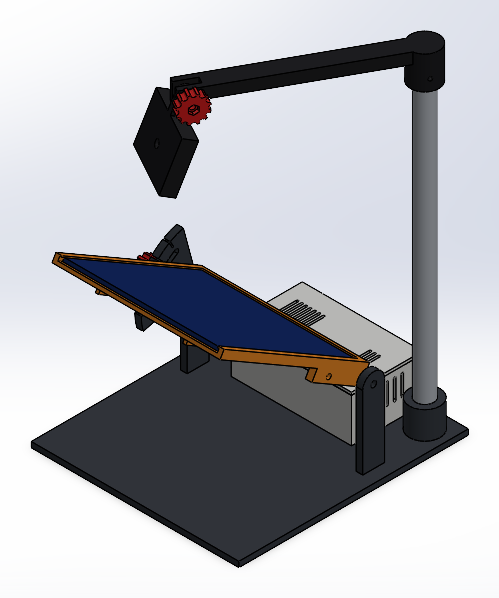
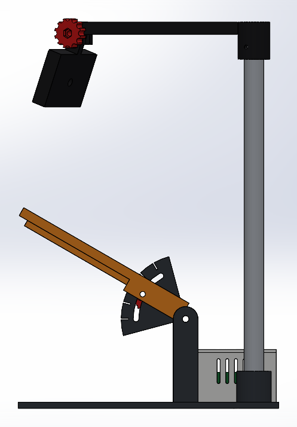

# CAD de SIMON — estación de inspección del panel solar

> La **caja de la PCB para imprimir** tiene su propia carpeta: [caja_pcb/](caja_pcb/README.md)
> (hueco de 90.5 × 52.5, labio/escalón, STL listos para la Adventurer 5M). La caja que aparece
> en esta estación es el concepto anterior.
>
> La **base giratoria** (turntable de Ø100 con clic cada 15° y seguro) está en
> [turntable/](turntable/README.md).

Modelo nativo de **SolidWorks 2025**: piezas `.SLDPRT` con árbol de operaciones y croquis
acotados, más un ensamble `.SLDASM`. Se genera por la API de SolidWorks desde Python, así
que se puede editar de dos formas: directo en SolidWorks, o cambiando las medidas de
`modelo.py` y volviendo a correrlo.



## Concepto

- **Base** de 190 × 210 mm con las dos **torres del pivote** integradas.
- **Marco del panel** (145 × 145 × 3 mm): el panel entra deslizándose por el frente y lo
  retiene una ceja de 1.5 mm en los otros tres lados. Tiene paso para el cable.
- **Inclinación 0–60°**: el marco gira sobre un eje M5 en su borde trasero. La torre
  izquierda tiene un **abanico con ranura en arco** y marcas cada 15°; una **perilla
  moleteada** (como la del smart stand) aprieta un tornillo M4 que corre por la ranura y
  fija el ángulo.
- **Caja de la PCB** detrás del panel: apoyos para la placa de 88 × 50, postes en la tapa
  que la sujetan, ventilación lateral y en la tapa, salidas para el USB del ESP32 y el
  cable del panel, y una **ventana sobre la LDR** (si no, quedaría a oscuras dentro de la caja).
- **Mástil** (tubo de aluminio Ø16 × 300) en un zócalo de la base, con un **brazo** que
  gira para apuntar al centro del panel y una **base para la webcam** que se inclina con
  otra perilla. La base tiene una ceja de 12 mm para el clip tipo monitor y un agujero de
  1/4" para la rosca de trípode, así sirve para casi cualquier webcam AVerMedia.



## Archivos

| Archivo | Qué es |
|---|---|
| `solidworks/SIMON_estacion.SLDASM` | Ensamble completo (panel a 30°) |
| `solidworks/*.SLDPRT` | Piezas; las `ref_*` son solo referencia (panel y PCB) |
| `stl/*.STL` | Las 7 piezas para imprimir |
| `SIMON_estacion.STEP` | Ensamble en formato neutro (para Fusion u otro CAD) |
| `capturas/` | Vistas de cada pieza y del ensamble |
| `modelo.py` | Medidas y construcción de cada pieza |
| `ensamble.py` | Posición de cada pieza en el ensamble (`python ensamble.py 45` lo arma a 45°) |
| `swlib.py` | Puente Python → API de SolidWorks |

## Imprimir

Todas caben en una cama de 220 × 220 mm. PLA o PETG, 3 perímetros, 20–25 % de relleno.

| Pieza | Cant. | Orientación sugerida |
|---|---|---|
| `base_y_torres` | 1 | plana, torres hacia arriba |
| `caja_pcb` | 1 | piso abajo |
| `tapa_caja` | 1 | cara superior abajo (postes hacia arriba) |
| `marco_panel` | 1 | placa abajo, costillas hacia arriba (lleva soporte bajo las cejas) |
| `perilla_M4` | 2 | arandela abajo |
| `brazo_camara` | 1 | barra plana sobre la cama, con soporte en el zócalo |
| `base_webcam` | 1 | ceja plana sobre la cama |

## Tornillería

| Qué | Cant. | Dónde |
|---|---|---|
| Tornillo M5 × 20 + tuerca | 2 | eje del panel (tuerca en la costilla del marco) |
| Tornillo M4 × 25 + tuerca | 1 | bloqueo del ángulo (cabeza en la perilla, tuerca en la costilla) |
| Tornillo M4 × 25 + tuerca | 1 | inclinación de la webcam (con la otra perilla) |
| Tornillo M3 × 10 + tuerca | 2 | caja a la base |
| Tornillo M4 (prisionero) | 1 | fija el brazo al mástil |
| Tubo de aluminio Ø16 × 300 mm | 1 | mástil |
| Tornillo 1/4"-20 corto | 1 | solo si la webcam se monta por su rosca de trípode |

## Pendiente / a revisar

- **Modelo exacto de la webcam AVerMedia.** La base es genérica (clip de monitor o rosca de 1/4").
  Con el modelo se ajusta la ceja y se puede dibujar la cámara en el ensamble.
- **Holgura a 60°:** el borde del panel queda unos 30 mm por debajo de la base de la webcam.
  Si la cámara cuelga mucho, subir `MASTIL_L` en `modelo.py` o limitar `ARCO_MAX`.
- **Espesor real del panel:** está en 3 mm (`PANEL_T`).

## Regenerar

Requiere SolidWorks 2025 abierto o instalado y `pip install pywin32 pillow`. La primera vez
hay que generar los envoltorios de la API:

```bash
python -c "import sys, win32com.client.makepy as m; sys.argv=['makepy', r'C:\Program Files\SOLIDWORKS Corp\SOLIDWORKS\sldworks.tlb']; m.main()"
```

Después:

```bash
python modelo.py && python ensamble.py
```

`modelo.py` solo cierra los documentos que estén dentro de `cad/solidworks/` antes de
sobrescribirlos; no toca otros archivos abiertos en SolidWorks.
