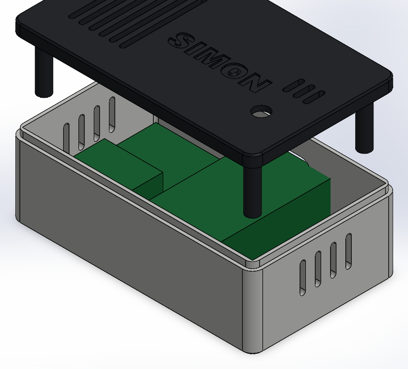
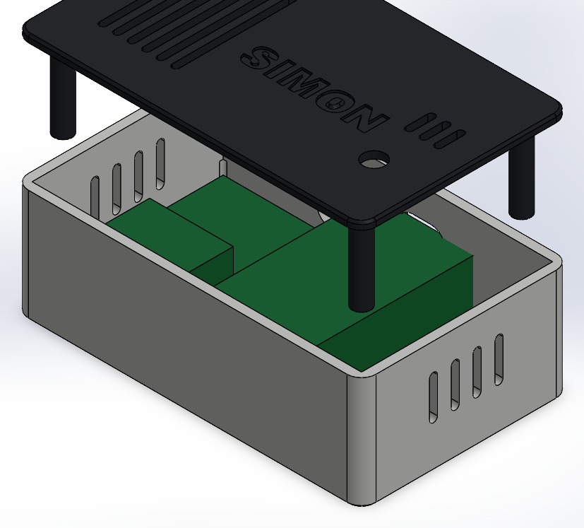

# Caja de la PCB de SIMON

Caja con tapa para la PCB, en SolidWorks 2025 (piezas nativas con árbol y cotas). Pensada
para imprimirse en una **Flashforge Adventurer 5M con boquilla de 0.4 mm**, sin soportes.




## Medidas

| | |
|---|---|
| Exterior | 95.5 × 57.5 × 33 mm (caja 30.9 + tapa) |
| Hueco de la PCB | **90.5 × 52.5 mm** (placa real + ~0.3 de tolerancia) |
| Paredes | 2.5 mm |
| Piso y tapa | 2.0 mm (10 capas de 0.2; ahorra filamento sin perder rigidez) |
| PCB | apoyada 4 mm sobre el piso (las soldaduras van abajo) |
| Espacio sobre la PCB | 23.4 mm (el INA219 sobre su header mide ~20 mm) |
| Material | 42.9 cm³ macizo: caja 30.4 + tapa 12.5 (≈ 53 g de PLA si fuera 100 % lleno) |

## Cierre labio / escalón (lip/groove)

- **Caja:** la franja interior de la pared (1.25 mm, unas 3 líneas de 0.42) sube 2.4 mm sobre el borde. Es el **labio**.
- **Tapa:** su borde exterior (1.05 mm) baja 2.5 mm y abraza el labio. Es el **escalón**; por fuera queda al ras con la caja.
- **Holgura:** 0.2 mm por lado, un ajuste firme a presión. Si queda muy duro, sube `HOLG_LG` a 0.25 en `caja_simon.py` y regenera.

La API de SolidWorks no permite crear la operación nativa *Lip/Groove*, así que está
modelada como dos operaciones con nombre: `Labio_lip` en la caja y `Escalon_groove` en la tapa.
Si prefieres la operación nativa de SolidWorks, usa la variante plana:

```bash
python caja_simon.py --plano
```

Genera `caja_simon_plano.SLDASM`: la tapa apoyada directo sobre la caja, sin labio, igual
que la primera caja. Ahí aplicas *Insertar → Operaciones de sujeción → Labio/Ranura*.



## Detalles de diseño

- **La PCB se ubica con las paredes**: no lleva agujeros. Descansa en 4 apoyos de esquina y los **4 postes de la tapa** la aprietan contra ellos (0.1 mm de aire).
- **Alivios de Ø2 en las esquinas interiores:** la impresora redondea las esquinas y la placa, que es cuadrada, se trabaría. Con el alivio entra libre.
- **Pared trasera:** salida para el **USB del ESP32** y para el **cable del panel** (bornera J1). El frente queda limpio.
- **Ventilación:**
  - Ranuras verticales en las paredes cortas, que se imprimen sin soporte.
  - Ranuras en la tapa sobre las resistencias de carga y el INA219, que son lo que más calienta.
  - Tres ranuras junto al LM35.
- **Ventana de Ø6 sobre la LDR:** sin ella, la LDR quedaría a oscuras dentro de la caja.
- **"SIMON" en bajo relieve** (0.6 mm) en la tapa. Como esa cara va contra la cama, sale nítido.
- **Chaflán de 0.6 mm** en los bordes que tocan la cama, contra la pata de elefante. No lleva redondeos abajo porque se imprimen mal.

## Imprimir (Flashforge Orca, perfil *Adventurer 5M 0.4 Nozzle*)

Los STL de `stl/` ya vienen orientados: caja con el piso abajo, tapa con su cara plana abajo
y los postes hacia arriba. Solo hay que importarlos.

| Ajuste | Valor |
|---|---|
| Material | PLA (o PETG) |
| Altura de capa | 0.2 mm |
| Perímetros (wall loops) | 3: con 2.5 mm la pared sale maciza y el labio sale como perímetros |
| Capas superiores / inferiores | 4 / 4 |
| Relleno | 15 % giroide (solo afecta piso, tapa y postes) |
| Soportes | ninguno |
| Costura (seam) | alineada atrás, para que quede en la pared del USB |
| Compensación pata de elefante | 0.1 mm |

El slicer dará los gramos exactos. Con estos ajustes debería quedar por debajo del valor macizo.

**Prueba de ajuste:** antes de imprimir todo, en Orca puedes cortar (*Cut*) los 5 mm superiores
de la caja y la tapa sin los postes. Así pruebas el labio en pocos minutos.

## Supuestos a confirmar

- **ESP32 montado sobre headers hembra de 8.5 mm.** De eso sale la altura de la salida USB. Si lo sueldan directo, la salida queda alta: ajusta `usb_y` en `caja_simon.py`.
- **Placa recortada con el diseño de 88 × 50 centrado** dentro de los 90.5 × 52.5. Las salidas tienen holgura (13 × 8 y 12 × 7) para absorber 1 mm de diferencia.

## Archivos

| Archivo | Qué es |
|---|---|
| `caja_simon.SLDASM` | Ensamble (caja + PCB de referencia + tapa) |
| `caja_simon_base.SLDPRT`, `caja_simon_tapa.SLDPRT` | Las piezas |
| `*_plano.*` | Variante sin labio, para el Lip/Groove nativo |
| `stl/` | Listos para el slicer |
| `caja_simon.STEP` | Para abrir en otro CAD |
| `caja_simon.py` | Medidas y construcción; se regenera con `python caja_simon.py` |
