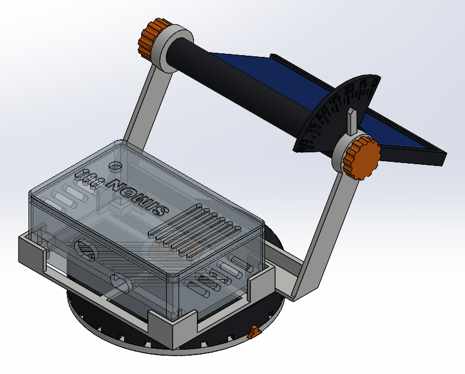
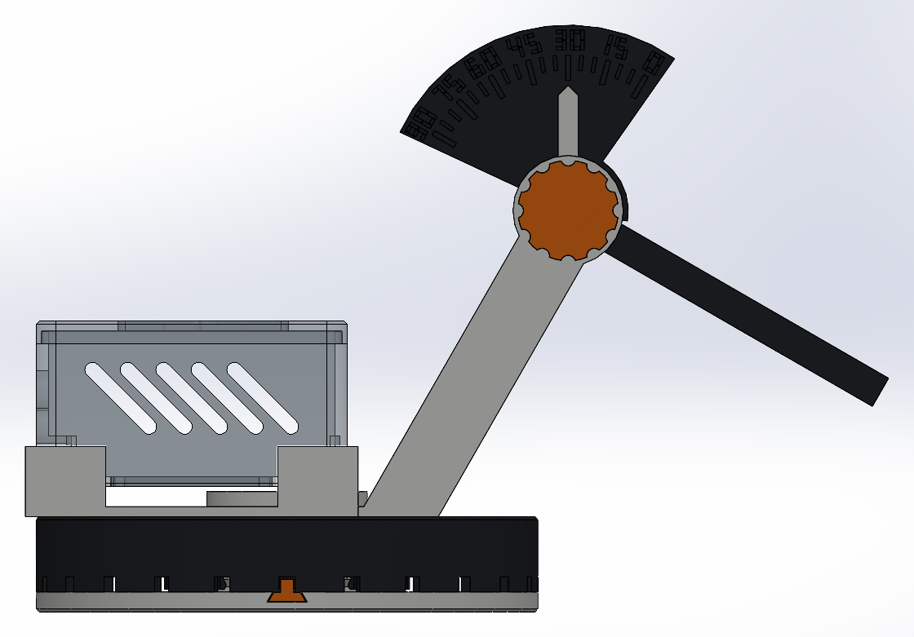
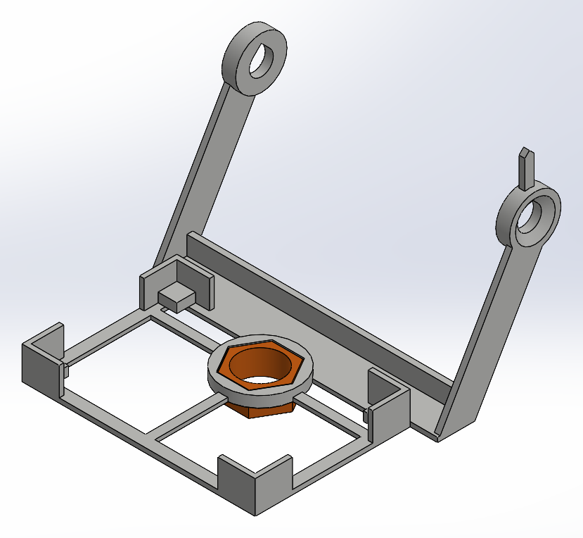
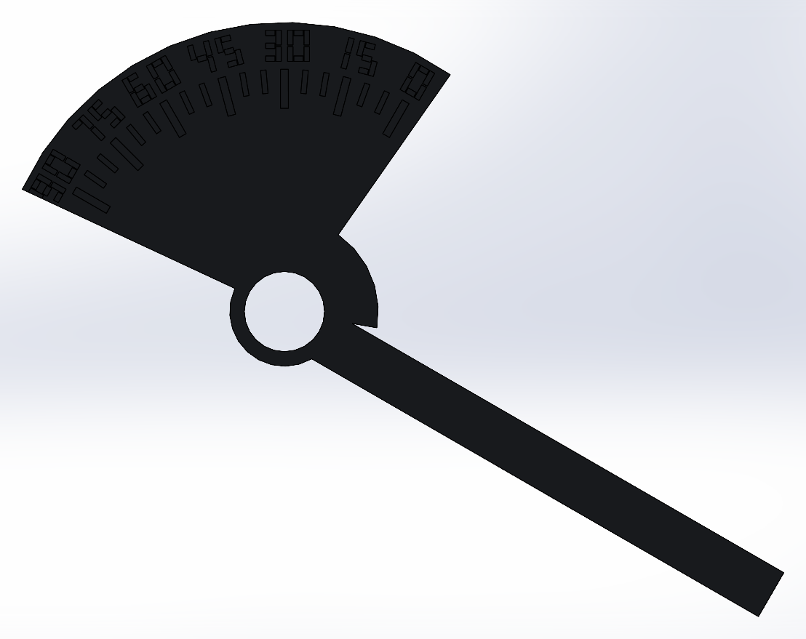
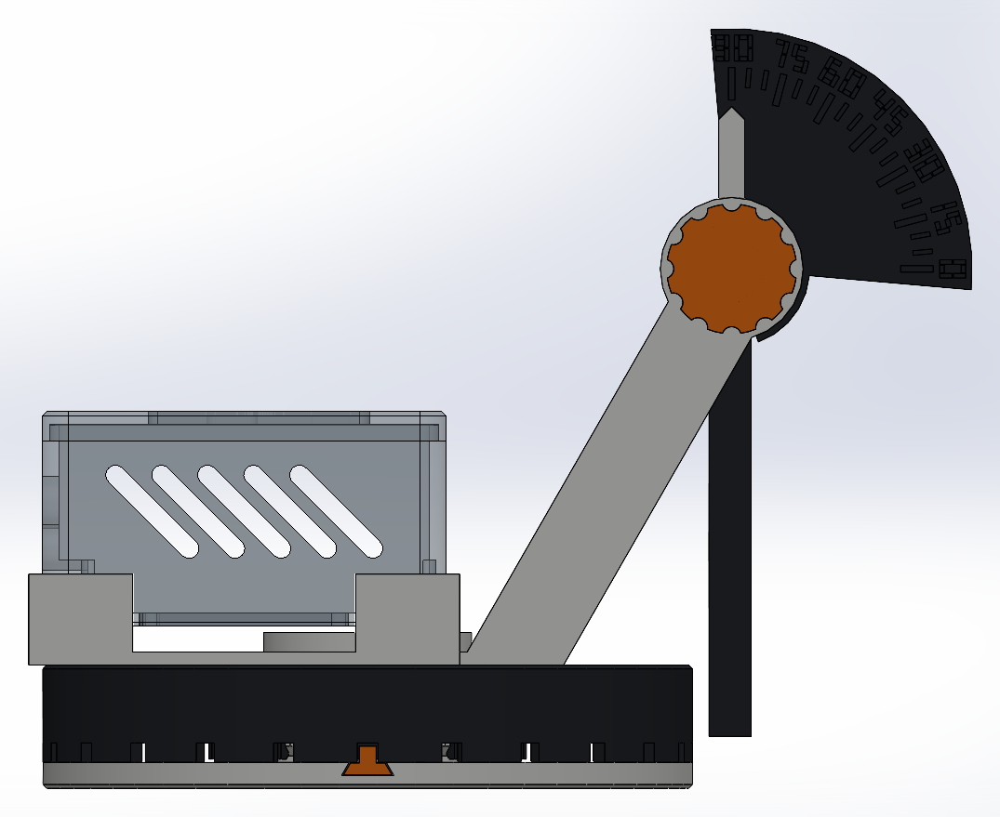

# Módulo del panel de SIMON

El turntable, la caja de la PCB y el panel, montados juntos. El panel se inclina como en un
phone holder: aflojas la perilla, lo pones en el ángulo que quieres y aprietas. Un
transportador marca el ángulo.

Es **una sola pieza de SolidWorks** (`modulo_panel.SLDPRT`) con **cuerpos separados** que no se
fusionan. Así ves cómo queda todo junto sin armar un ensamble:

| Cuerpo | Qué es | Se imprime |
|---|---|---|
| `Base_fija`, `Plato_gira`, `Seguro` | El [turntable](../turntable/README.md); el plato ahora tiene un hexágono en el centro | sí (STL en `turntable/stl`) |
| `Buje` | Hexágono que entra a presión en el plato y en el soporte | sí |
| `Soporte` | Una sola pieza: abraza la caja y sostiene las dos torres de la bisagra | sí |
| `Marco_panel` | Donde va el panel; gira sobre el tornillo y lleva el transportador | sí |
| `Tornillo`, `Tuerca` | El tornillo de perilla que pasaste y su tuerca. En el modelo van simplificados (sin rosca), con el mismo perfil y asiento cónico; se imprimen los STL originales | sí (`stl/`) |
| `Caja_ref`, `Tapa_ref`, `Panel_ref` | Solo referencia: la caja (ligada a `caja_pcb`, se actualiza si cambia) y un panel de 108 × 61.5 | no |

## Cómo va armado

- **Buje.** El soporte no abraza todo el turntable: se ubica con un buje hexagonal en el agujero del centro.
  - Holgura de 0.1 por lado en el plato y de 0.05 en el soporte, donde el buje se queda puesto.
  - Centra el soporte y, como es hexagonal, no lo deja girar.
  - Se puede montar en 6 posiciones, cada 60°.
  - El buje es pieza aparte porque un pivote que saliera por abajo del soporte o por arriba del plato no se podría imprimir sin soportes: los dos se imprimen con esa cara en la cama.
- **Caja.**
  - Entra en 4 esquineros con 0.15 de holgura por lado y se saca levantándola.
  - Descansa en 4 patas de 4 mm: así respira la rejilla del piso y ya no necesitas las patitas de hule.
  - El USB y la bornera miran hacia afuera, al lado contrario del panel. El cable del USB cuelga por la orilla; ya no pasa por el centro del turntable, porque la base va plana sobre la mesa y no tendría por dónde salir.
- **Bisagra.**
  - El tornillo atraviesa la torre, el tubo del marco y la otra torre.
  - Torres y tubo tienen el mismo hueco que el original (Ø10.25 para el tornillo de Ø9.56).
  - Las caras de afuera de las torres llevan el mismo asiento cónico del stand original, donde asientan la perilla y la tuerca.
  - Entre el tubo y cada torre quedan 0.1 mm: al apretar la perilla, las torres se cierran sobre el tubo y el roce sostiene el ángulo.
- **Panel.**
  - El hueco mide 108 × 61.5, sin holgura extra. Va acostado: el lado de 108 corre a lo largo del eje.
  - Entra deslizándose por el lado de la tuerca y lo retienen cejas de 1.5 mm en los otros tres lados.
  - Al llegar al fondo, una lengüeta con un diente cae detrás del panel y lo traba. Para sacarlo, aprieta la lengüeta desde atrás y deslízalo.
  - El fondo tiene dos ventanas para los cables del panel. Las ventanas también ahorran filamento.
- **Ángulo.**
  - Va de **0° (horizontal) a 90° (vertical)**. A 90° el marco cuelga por fuera del turntable, 8 mm sobre la mesa.
  - El transportador va pegado al marco y gira con él. Tiene marcas cada 5° y números cada 15°.
  - El índice está fijo en la torre de la perilla y apunta hacia arriba: el número que queda bajo el índice es la inclinación del panel.

## Grosor del panel (editable)

El grosor del panel es la variable global **`Grosor_panel`** (3 mm). Para cambiarla:

1. En SolidWorks, abre *Herramientas → Ecuaciones*.
2. Cambia el valor de `Grosor_panel`.
3. Reconstruye. Las paredes, las cejas y el panel de referencia se ajustan solos.

Sirve para paneles de 2 a 4 mm.

El marco aparece inclinado a 30° por la operación `Inclinar_marco`, la última del árbol. Edítala para ver cualquier ángulo o suprímela para verlo horizontal.

## Medidas

| | |
|---|---|
| Eje de la bisagra | 80 mm sobre la mesa y 56 mm del centro del turntable, hacia el lado del panel |
| Soporte | 123 × 119 mm de planta, 86 mm de alto con el índice |
| Tornillo | 133.8 mm (el original mide 100.6); aprieta 123.2 mm entre caras. Se alarga estirando solo la parte lisa: la rosca y la tuerca quedan idénticas al original |
| Paredes | Entre 1.5 y 2.5 mm. Más gruesos solo el tornillo y los jefes de las torres (6 mm, para el asiento cónico) |
| Material macizo | Soporte 22.6 cm³, marco 20.4, buje 2.2, tornillo 10.7, tuerca 2.1 |

## Imprimir (Flashforge Orca, perfil *Adventurer 5M 0.4 Nozzle*)

Todos los STL de `stl/` ya vienen orientados y **ninguno lleva soportes**:

| STL | Orientación | Nota |
|---|---|---|
| `soporte.stl` | Base en la cama, torres hacia arriba | Los agujeros del tornillo tienen techo en punta para imprimirse acostados |
| `marco_panel.stl` | Parado sobre el lado del transportador | El tubo sale redondo; las marcas y los números quedan contra la cama, nítidos. Ponle brim |
| `buje.stl` | Parado | |
| `tornillo.stl` | Parado, perilla abajo | Mide 134 mm de alto: ponle brim y bájale la velocidad en la parte de arriba |
| `tuerca.stl` | Perilla abajo | Es el original sin cambios |
| `turntable_plato.STL` | (en `turntable/stl`) cara de arriba en la cama | Reimprímelo: ahora lleva el hexágono del buje |

Compensación de pata de elefante: 0.1 mm. Los hexágonos del plato y del soporte tienen un
chaflán de 0.4 en la boca para que entre el buje.

## Armado

1. Mete el buje a presión en el hexágono de abajo del soporte. Se queda puesto.
2. Desliza el panel en el marco por el lado abierto hasta que la lengüeta haga clic. Hazlo con el marco fuera: con el marco montado, la torre no deja pasar el panel.
3. Pon el marco entre las torres. Mete el tornillo por la torre del índice, con la perilla de ese lado, y enrosca la tuerca del otro.
4. Pon el soporte sobre el plato, con el buje en el hexágono, y la caja en los esquineros.
5. Para inclinar el panel: afloja la perilla, gira el marco hasta el ángulo que marca el índice y aprieta.

## Ajustes

Todas las medidas están al inicio de `modulo_panel.py`; si cambias alguna, vuelve a correr el script.

| Si… | Cambia |
|---|---|
| El buje entra muy duro o muy flojo en el plato | `HOLG_BUJE` (0.1) |
| El buje no se queda en el soporte | `APRIETE_BUJE` de 0.05 a 0.0 |
| La caja entra muy justa | `HOLG_CAJA` (0.15) |
| El panel no se sostiene aunque aprietes | Lija las caras de las puntas del tubo, o baja `HOLG_TORRE` |
| Otro panel | `PANEL_L`, `PANEL_W`; el tornillo se alarga solo (sale de `AGARRE`) |

## Croquis

Todos los croquis quedan **totalmente definidos** (en negro) y acotados desde el origen.
Sigue sin definirse `Croquis_ranuras_clic` del turntable: son 24 triángulos que SolidWorks
no termina de acotar solo.

## Archivos

| Archivo | Qué es |
|---|---|
| `modulo_panel.SLDPRT` | La pieza con todos los cuerpos |
| `stl/` | Lo que se imprime, ya orientado |
| `capturas/` | Vistas: armado, de lado, a 90°, soporte y marco |
| `modulo_panel.py` | Medidas y construcción; se regenera con `python modulo_panel.py` |
| `tornillo.py` | Alarga el tornillo original estirando solo su parte lisa (la rosca queda igual) |
| `originales/` | El tornillo (`tablet_bolt.stl`) y la tuerca (`nut.stl`) que pasaste |
