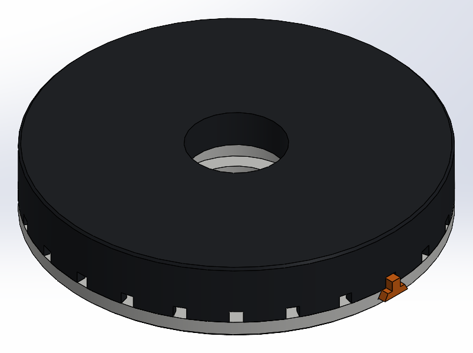
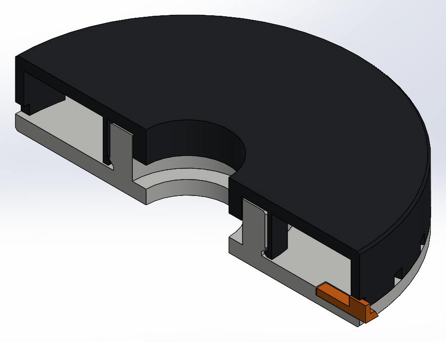
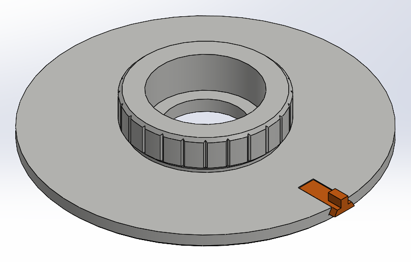
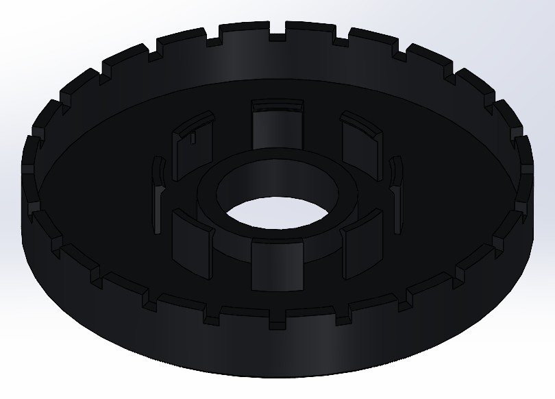

# Turntable de SIMON

Base giratoria para la estación, inspirada en el **LEGO Turntable 4x4**. Gira sin balero, solo
con piezas impresas, hace **clic cada 15°** y tiene un **seguro** para dejarla trabada.

Es **una sola pieza de SolidWorks** (`turntable_simon.SLDPRT`) con **tres cuerpos separados**
que no se fusionan:

| Cuerpo | Qué es | Color |
|---|---|---|
| `Base_fija` | Disco de Ø100 que va sobre la mesa, con el núcleo del mecanismo al centro | gris claro |
| `Plato_gira` | Disco de Ø100 con falda que gira encima; aquí va tu acople | negro |
| `Seguro` | Pasador que traba el plato | naranja |

## Cómo funciona

- **Apoyo:** el plato descansa sobre la base por el borde de su falda (Ø95–100, 2.5 mm de pared).
  Al apoyar en el diámetro más grande posible, el plato no cabecea aunque la estación
  quede descentrada. Desliza plástico contra plástico, sin balero.
- **Centrado y retención (la "rueda" del LEGO, Ø49):**
  - La base tiene un núcleo con una garganta abajo.
  - El plato tiene 8 dedos flexibles con gancho que abrazan el núcleo y se traban bajo la garganta: así no se levanta.
  - Un tubo del plato entra en el núcleo con 0.25 mm de holgura y lo centra.
- **Clics cada 15°:** el núcleo tiene 24 ranuras en V y dos de los dedos (a 90° y 270°) llevan una costilla que cae en ellas.
- **Seguro:**
  - La falda tiene 24 muescas, alineadas con los clics.
  - El seguro corre por un canal en cola de milano de la base, así que no se sale hacia arriba.
  - **Empújalo** y su diente entra en una muesca: queda trabado.
  - **Jálalo unos 5 mm** y gira libre otra vez.
  - Está en la orilla, así que lo alcanzas aunque la estación esté encima.
- **Agujero central de Ø24** en la base y en el plato. Arriba, el plato tiene un **hexágono de
  24 mm entre caras y 6 de hondo** donde entra a presión el buje del soporte del panel
  ([modulo_panel](../modulo_panel/README.md)). Ya no sirve de paso de cables: la base va plana
  sobre la mesa y el cable no tendría por dónde salir. El USB baja por la orilla.

## Medidas

| | |
|---|---|
| Diámetro | 100 mm (base y plato) |
| Alto total | 19 mm (base 4 + falda 12 + plato 3) |
| Mecanismo | Ø49: núcleo de Ø46 y dedos de 1.2 mm |
| Holguras | 0.3 entre lo que se mueve; 0.2 en el canal del seguro |
| Material | Base 38.8 cm³, plato 33.9 cm³, seguro 0.2 cm³ (macizo; el slicer dará los gramos reales) |

## Imprimir (Flashforge Orca, perfil *Adventurer 5M 0.4 Nozzle*)

Los STL de `stl/` ya vienen orientados y **ninguno lleva soportes**:

| STL | Orientación |
|---|---|
| `turntable_base.STL` | Piso en la cama, núcleo hacia arriba. El chaflán del núcleo está a 45° |
| `turntable_plato.STL` | Cara de arriba en la cama, dedos y falda hacia arriba |
| `turntable_seguro.STL` | Plano, con el diente hacia arriba |

| Ajuste | Valor |
|---|---|
| Material | PLA (o PETG, que flexiona mejor en los dedos) |
| Altura de capa | 0.2 mm |
| Perímetros | 3 |
| Relleno | 15–20 % giroide |
| Planchado (ironing) | En la base, solo superficie superior: es donde desliza la falda |
| Compensación pata de elefante | 0.1 mm |

## Armado

1. Mete el seguro en el canal desde la orilla, con el diente hacia arriba.
2. Pon una pizca de vaselina o grafito en la cara de arriba de la base, donde apoya la falda, y en el núcleo.
3. Centra el plato sobre el núcleo y **presiona hasta que haga clic**. Los dedos se abren y se traban bajo la garganta. Hay que apretar firme, como cerrar un tupper.
4. Gíralo: debe hacer clic cada 15°. Para trabarlo, empuja el seguro.

Para desarmarlo, jala el plato hacia arriba con fuerza. Los ganchos tienen una cara a 45°, así que sueltan sin romperse.

## Ajustar el encaje

Todas las medidas están al inicio de `turntable_simon.py`. Si cambias alguna, vuelve a correr el script.

| Si… | Cambia |
|---|---|
| Cuesta demasiado encajarlo | `GANCHO` de 0.7 a 0.5 |
| El plato queda flojo o se sale | `GANCHO` a 0.9 |
| Los clics son muy suaves o muy duros | `COSTILLA` (0.3): sube o baja de 0.1 en 0.1 |
| Roza al girar | `HOLG` de 0.3 a 0.4 |
| El seguro entra muy apretado | `HOLG_SEG` de 0.2 a 0.3 |

## Para tu acople

La cara de arriba del plato es un disco plano de Ø100 con el hexágono del buje al centro. El
soporte de la caja y del panel ya está hecho en [modulo_panel](../modulo_panel/README.md). Si
modelas otro acople en este mismo archivo:

- Crea su primera operación con **"Fusionar resultado" desmarcado** y luego usa *Insertar → Operaciones → Combinar* para sumarlo solo a `Plato_gira`.
- Si dejas "Fusionar resultado" marcado, SolidWorks puede juntar cuerpos que solo están cerca, aunque no se toquen.
- Lo mismo vale para cualquier cosa que agregues a la base. El árbol ya tiene tres ejemplos (`Sumar_*`).

## Archivos

| Archivo | Qué es |
|---|---|
| `turntable_simon.SLDPRT` | La pieza con los tres cuerpos (dibujada armada y con el seguro puesto) |
| `stl/` | Un STL por cuerpo, listo para el slicer |
| `capturas/` | Vistas, incluido un corte por la mitad |
| `turntable_simon.py` | Medidas y construcción; se regenera con `python turntable_simon.py` |
